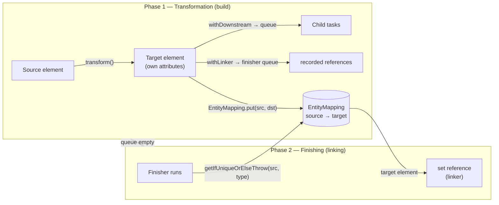
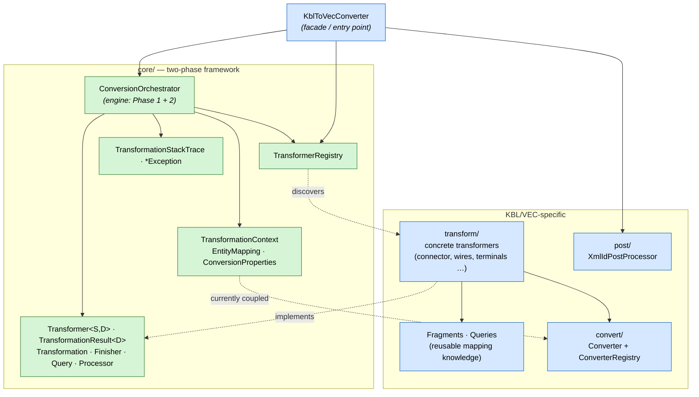
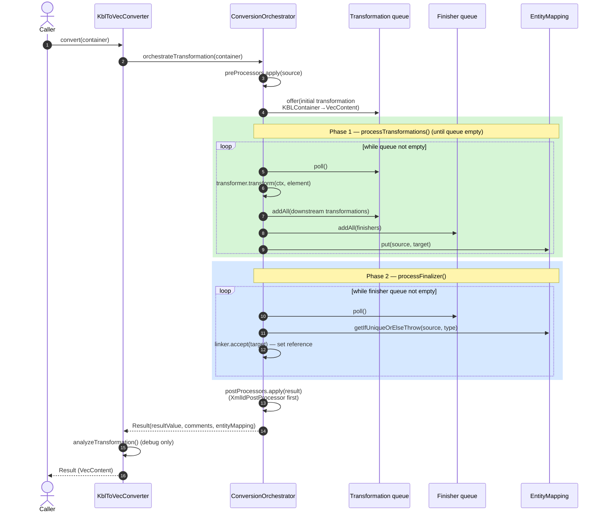
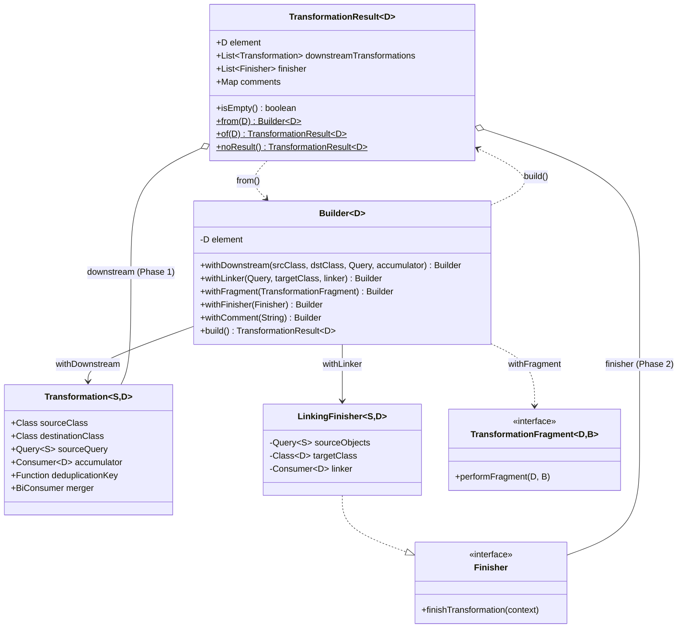
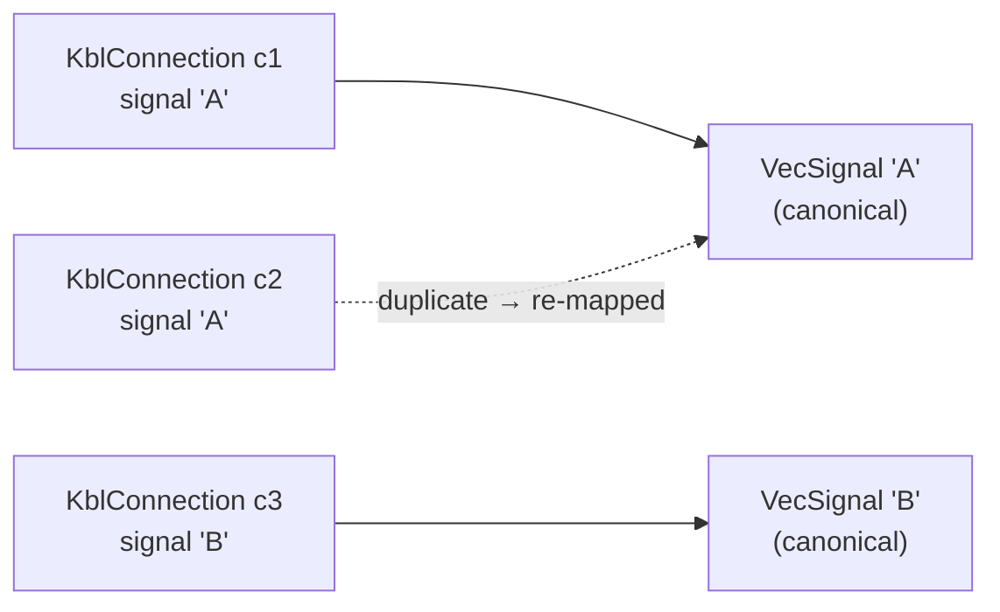
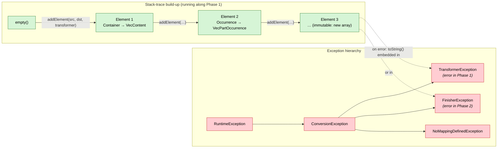
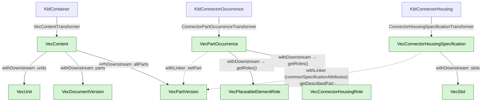
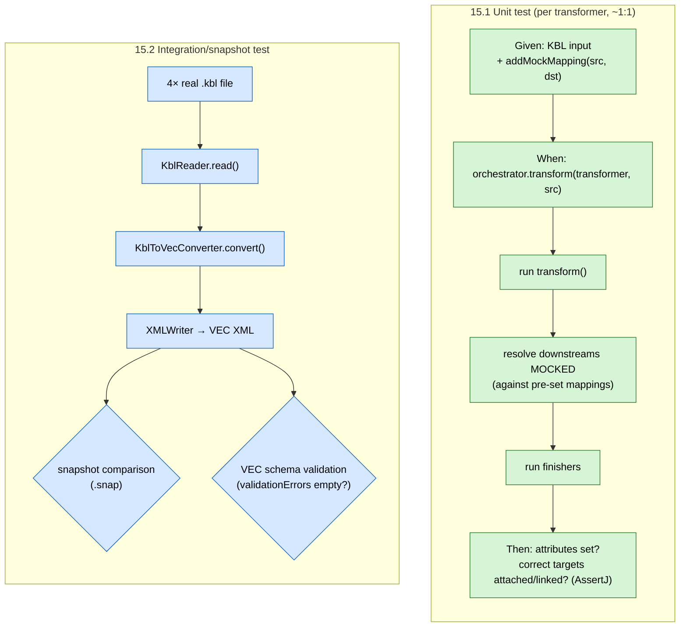

# kbl2vec — Architecture (Two-Phase Conversion)

> Reference document for the architecture of the `kbl2vec` module, intended both for working on `kbl2vec`
> and for designing similar two-phase model-to-model converters (from VEC, to VEC, or between any two
> serializable models).
> Status: `kbl2vec` module, branch `develop`.
> Sections 1–13 describe **how** the converter works and, in the **Why** paragraphs, why it is built that way.
> Section 14 is a practical checklist for extending the converter. Sections 16–18 collect the design decisions,
> the non-goals and limitations, and what a new converter built on the same framework has to decide for itself.
> Section 21 lists what is still open.
>
> Where a choice was not deliberate, this document says so ("incidental") — such choices are free to change.

---

## 1. Overview & Core Idea

`kbl2vec` converts a KBL model (`KBLContainer`, kbl-v25) into a VEC model (`VecContent`, vec-v2x).
The central problem of any model-to-model conversion: **cross-references**. A source element B references
source element A; in the target, B' must point to A'. As long as A' does not yet exist, B' cannot be linked.

The solution is a **two-phase conversion**:

- **Phase 1 — Transformation (build):** Every source element is translated into its target element(s).
  Only the element's *own* attributes are set, and the source→target mapping is registered in a central map
  (`EntityMapping`). References to other elements are **not** resolved immediately, but are recorded as *finishers*
  (deferred linking tasks). Phase 1 also discovers the next elements to be transformed dynamically
  (*downstream transformations*).
- **Phase 2 — Finishing (linking):** Once all elements exist and are registered in `EntityMapping`, all recorded
  finishers run. They look up source element → target element in the map and set the references.

The entire process is **data-driven and self-expanding**: there is no central "mapping list" that knows all
elements. Instead, each transformer declares which *dependent* elements should be transformed next. Starting from a
single root element (`KBLContainer`), the whole graph is spanned (a kind of breadth-first traversal over a work queue).

The following diagram shows both phases at a glance — Phase 1 builds the target elements and fills the
`EntityMapping`, Phase 2 uses that mapping to set the cross-references:



> **Key idea:** `withDownstream` = "create this element" (Phase 1). `withLinker` = "reference it later"
> (Phase 2). Only once *all* elements have been created and registered in `EntityMapping` during Phase 1 can the
> references be resolved reliably in Phase 2.

**Why.** Both models are models for *serialization into files* (XML via JAXB here; the same holds for JSON or any
other tree-shaped format). Such a model is a containment **tree** with cross-references (IDREFs) on top, i.e. a
**graph**: every element has exactly one parent in the tree, and every reference must point to an element that is
attached somewhere in that tree. A reference can only be set directly if its target already exists, and a
deterministic processing order was a goal. Separating "create and attach" (Phase 1) from "reference" (Phase 2)
satisfies both without having to know a valid creation order in advance. The alternatives that were considered and
rejected are recorded in section 16.

**Why target-driven.** The conversion is designed **from the target model's point of view**: a target parent asks for
its children (`withDownstream`), and the transformers navigate the source model to find what that branch needs. The
target model (VEC) is considerably more structured than the source (KBL), which mixes semantic concepts — a KBL
`Node`, for example, becomes a `TopologyNode` *and* a `GeometryNode2D` or `GeometryNode3D` in different places of the
target. Driving the conversion from the target keeps the rule "one transformer = one source type → one target type"
intact.

---

## 2. Layers & Packages

```
com.foursoft.harness.kbl2vec
├── KblToVecConverter                 ← public entry point (facade)
├── ReflectionsBasedTransformerRegistry ← discovers transformers via classpath scan
├── core/                             ← the two-phase framework (generic in intent, see below)
│   ├── ConversionOrchestrator        ← the engine (Phase 1 & Phase 2 loops, deduplication)
│   ├── Transformer<S,D>              ← SPI: a single element-type mapping (Phase 1)
│   ├── TransformationResult<D>       ← return value of a transformer (+ Builder)
│   ├── Transformation<S,D>           ← a recorded downstream task (+ optional deduplication key/merger)
│   ├── Finisher / LinkingFinisher    ← Phase 2 linking task
│   ├── Query<T>                      ← supplier of source elements (lazy)
│   ├── TransformationContext(+Impl)  ← shared state (mapping, properties, converters, IDs, cache, logger)
│   ├── EntityMapping                 ← source→target multimap + unique resolution
│   ├── ConversionProperties          ← default values / configuration
│   ├── Processor<D>                  ← pre-/post-processor SPI
│   ├── TransformationStackTrace(+Element) ← provenance / error tracking
│   └── *Exception                    ← Conversion/Transformer/Finisher/NoMapping
├── convert/                          ← converters (simple, non-referenceable value conversions)
│   ├── Converter<S,D>                ← SPI
│   ├── ConverterRegistry             ← holds the converter instances
│   └── StringToColor/Material/WireType/DateTime/LocalizedString, LocalizedString, DoublesToCartesianVector2D/3D
├── transform/                        ← the concrete transformers (the actual mapping knowledge)
│   ├── Fragments / Queries           ← reusable building blocks (see below)
│   ├── core/                         ← VecContentTransformer (root), Unit, ValueRange, CustomProperty …
│   ├── components/…                  ← grouped by domain: connector, wires, terminals, ee_components,
│   │                                   accessory, fixing, seals, plugs, protection, copack, assembly, common …
│   ├── contacting/, coupling/, geometry/, harness/, modules/, pdm/, placements/, signal/, topology/
├── post/                             ← XmlIdPostProcessor (post-processor)
└── utils/                            ← DeterministicXmlIdGenerator and other helpers
```

**The boundary of `core`.** `core` is *intended* to be the generic two-phase framework, and its concepts are meant to
carry over to other converters. In its current state it is **not** fully model-agnostic. Known couplings:

- `ConversionProperties` imports VEC enums (`VecLanguageCode`, `VecValueDetermination`) and
  `transform.geometry.Clamping`, and its defaults are converter-specific.
- `TransformationContext`, `TransformationContextImpl` and `ConversionOrchestrator` depend on the concrete
  `convert.ConverterRegistry`, and the orchestrator constructs it itself.
- `TransformationResult.Builder.withCommentOnDetail` takes a `navext-runtime` `Identifiable`.

**Why.** This is deliberately pragmatic and at the same time technical debt: the focus was a working KBL→VEC converter.
`core` has only ever been used by `kbl2vec`; there is no separate artifact and no stability promise for its API.
Reusing it in another converter means planning a refactoring that cuts these couplings first (see section 18).

**Package layout of `transform/`.** The intended rule is to group transformers **by target domain**. The structure grew
by hand during implementation and is not fully consistent; when adding a transformer, follow the neighbouring
transformers of the same target concept rather than looking for a strict rule. Most transformers are named after their
target (`…SpecificationTransformer`, `…RoleTransformer`, `…OccurrenceTransformer`).

The following layered view makes the boundary between the framework and the model-specific knowledge visible
(green = generic in intent, blue = KBL/VEC-specific):



---

## 3. The Data Flow (Sequence)

`KblToVecConverter.convert(container)`:

1. **Create the orchestrator** — root types (`KBLContainer` → `VecContent`), `TransformerRegistry`,
   `ConversionProperties`. The internal `XmlIdPostProcessor` is registered, followed by the user-supplied
   pre-/post-processors.
2. **`orchestrateTransformation(source)`**:
   1. **Pre-processing**: the source runs through all `preProcessors` (pipeline).
   2. **Initial transformation**: a `Transformation<KBLContainer, VecContent>` with the accumulator
      `resultReference::set` is placed in the queue. The accumulator captures the root result.
   3. **Phase 1 — `processTransformations()`**: the work queue is drained until empty (see section 4). Along the way
      it continuously creates new downstream transformations and collects finishers.
   4. **Phase 2 — `processFinalizer()`**: the finisher queue is drained (see section 5).
   5. **Post-processing**: the result runs through all `postProcessors` (first `XmlIdPostProcessor`, then custom).
   6. **Result**: `Result<D>(resultValue, comments, entityMapping)`.
3. **`analyzeTransformation`** (only when debug logging is active): lists unmapped KBL classes and the
   KBL→VEC class mappings that were actually produced.



**The `Result` is part of the public contract.** Besides the converted model and the comments, `Result` deliberately
exposes the complete `EntityMapping` (source object → target object(s)), so that callers can trace where a target
element came from and run their own completeness analyses.

---

## 4. Phase 1 — Transformation in Detail

Engine: `ConversionOrchestrator`. Data structure: `Queue<TransformationHolder>` (`ConcurrentLinkedQueue`).

```
while ((holder = transformations.poll()) != null) {
    handleSingleTransformation(holder.transformation(), holder.currentStackTrace());
}
```

For each `Transformation<FROM,TO>`:

1. **Transformer lookup**: `transformerRegistry.getTransformer(sourceClass, destinationClass)` returns
   *all* transformers that serve `(FROM, TO)` (there can be several — e.g. multiple roles from one occurrence).
2. **Fetch source elements**: `transformation.sourceQuery().stream()` — the `Query` lazily supplies the inputs
   (0..n elements).
3. For each source element × each matching transformer: `transformer.transform(context, element)` →
   `TransformationResult<TO>`.
4. For each non-empty result (`!result.isEmpty()`, i.e. `element != null`):
   - If the transformation deduplicates and the result is a duplicate, it is folded into the canonical instance and
     handling stops here (section 6).
   - The **stack trace** is extended by one element (provenance: which transformer, which source/target object).
   - The **downstream transformations** from the result are appended to the queue (wrapped with the stack trace)
     → this expands the graph.
   - The **finishers** from the result are placed in the finisher queue (for Phase 2).
   - **`EntityMapping.put(element, result.element())`** registers the source→target mapping.
   - **Comments** are collected.
5. The produced target element is attached to the correct place in the parent target object via
   `transformation.accumulator()` (e.g. `VecContent::getPartVersions.add(...)`).

**Error handling:** if a transformer throws, the full `TransformationStackTrace` is embedded in a
`TransformerException` — so you can see the path of "who requested this transformation".

**Why every created element is attached immediately.** `withDownstream` always carries an accumulator, so an element
is placed into the containment tree in the same step in which it is created. There is no way to create an element
"for a reference" that has no home in the tree. That is the lesson from earlier model-to-model transformations built
on a `getOrCreate()` pattern: elements created on demand for a reference, but never attached because their branch was
never visited, only fail at serialization time (the XML-ID pass skips them, JAXB then fails with a missing ID), where
it is practically impossible to find out how they came about.

### Who requests whom

A transformer only runs if another transformer requests it with `withDownstream`. Responsibility follows the
**containment structure of the target model**: the target parent requests its children and attaches them through the
accumulator. Because every element of a tree-shaped target has exactly one parent, two different parents requesting
the same source object for the same target type deliberately produce **two** target instances. `EntityMapping` warns
about the ambiguous mapping, and a linker that later asks for that type fails (section 5). This is intended; see
section 17 for the linker resolution strategy that has been considered for such cases.

### The `Transformer<S,D>` Contract

```java
public interface Transformer<S, D> {
    TransformationResult<D> transform(TransformationContext context, S source);
}
```

Conventions followed by all concrete transformers:

- **Default constructor**: the `ReflectionsBasedTransformerRegistry` instantiates via the no-arg constructor.
- **Stateless**: transformers are stateless — this is a rule, not a convention. The registry creates one instance per
  `(S, D)` pair and `KblToVecConverter` reuses it for every conversion. State that is needed during a conversion
  belongs in the `TransformationContext` (section 9).
- **Type guard / `noResult()`**: if the `source` type does not match (source queries are often typed more broadly,
  e.g. `ConnectionOrOccurrence`), the transformer returns `TransformationResult.noResult()`. An empty result is
  ignored by the orchestrator (no mapping, no downstreams). Example: `ConnectorPartOccurrenceTransformer` only reacts
  to `KblConnectorOccurrence`.
- **Multiple mappings of one source element**: the same source element can be translated by several transformers into
  *different* target types (e.g. one occurrence → `VecConnectorHousingRole` **and** `VecPlaceableElementRole`). This
  is intentional; that is why `EntityMapping` is a **multimap**.

**Why broad queries with a type guard.** This is deliberate. The requester only states "turn every
`ConnectionOrOccurrence` into a `VecPartOccurrence`"; which transformer handles which subtype is hidden from it. When a
generic transformer later needs a specialised sibling for one subtype (e.g. connectors), the responsibility moves
between transformers and the requester does not change. Request a narrower type only when the target type determines
*where* the result has to be attached.

### `TransformationResult<D>` & the Builder (the heart of the DSL)

```java
record TransformationResult<D>(D element,
                               List<Transformation<?,?>> downstreamTransformations,
                               List<Finisher> finisher,
                               Map<Object,String> comments)
```

Almost always created via the fluent `Builder` (`TransformationResult.from(element)…build()`):

| Builder method | Purpose | Phase |
|---|---|---|
| `withDownstream(srcClass, dstClass, Query, BiConsumer<D,TO>)` | transform child elements; attach result to parent via consumer | creates Phase 1 task |
| `withDownstream(srcClass, dstClass, Query, Function<D, List<? super TO>>)` | as above, but the target list is supplied (`element -> element.getXyz()`) | Phase 1 |
| `withDownstream(…, deduplicationKey, merger)` | as above, but keeps only one target per key (section 6) | Phase 1 |
| `withLinker(Query<FROM>, targetClass, BiConsumer<D,TO>)` | deferred linking: look up FROM→TO in `EntityMapping` and set reference | creates Phase 2 finisher |
| `withLinker(Query<FROM>, targetClass, Function<D,List<? super TO>>)` | as above, insert into target list | Phase 2 |
| `withLinker(FROM, targetClass, Function…)` | convenience overload for a single source object | Phase 2 |
| `withFragment(TransformationFragment<D, Builder<D>>)` | apply a reusable building block (attributes + further downstreams/linkers) | both |
| `withFinisher(Finisher)` | attach an arbitrary finisher directly | Phase 2 |
| `withComment(String)` / `withCommentOnDetail(Identifiable, String)` | XML comment on the result/detail element | output |

**Core idea — `withDownstream` vs. `withLinker`:**

- `withDownstream` = "this child element does not exist yet, **create** it and attach the result here."
  → new Phase 1 task.
- `withLinker` = "this element is created **elsewhere**; **reference** it later." → Phase 2 finisher.

Exactly this separation solves the cross-reference problem.

The following class diagram shows the DSL and where the builder methods deposit their results — `withDownstream`
creates `Transformation` objects (Phase 1 work items), `withLinker`/`withFinisher` create `Finisher`s
(Phase 2 linking), `withFragment` delegates to a reusable building block:



### N:1 mappings

When several source elements together make up one target element without sharing a key, one of them is the
**leading** source: `Transformer<A, X>` navigates from A to B and C in the source model and maps their values as well.
No dedicated mechanism exists or is needed for this. Consequence: only `A → X` is registered in `EntityMapping`, so
linkers must reference X via A. (N:1 *with* a shared key is deduplication, section 6.)

---

## 5. Phase 2 — Finishing / Linking in Detail

Data structure: `Queue<FinisherHolder>`. After Phase 1:

```
while ((fh = finisher.poll()) != null) {
    fh.finisher().finishTransformation(transformationContext);   // on error → FinisherException(+stack trace)
}
```

Standard implementation `LinkingFinisher<S,D>`:

```java
sourceObjects.stream()
    .map(s -> context.getEntityMapping().getIfUniqueOrElseThrow(s, targetClass))
    .forEach(linker);   // linker sets the reference on the already-created target element
```

That is: at finishing time it is guaranteed that all target elements are present in `EntityMapping`.
`getIfUniqueOrElseThrow` resolves source→target **by type and uniquely**:

- 0 hits → `ConversionException` ("No transformation result found …").
- 1 hit → return it.
- multiple hits of the same target type → attempt an exact class match (`getClass() == destinationClass`);
  if it remains ambiguous → `ConversionException`. Already at `put`, `EntityMapping` warns when a source receives
  multiple targets of the same type (potentially ambiguous later resolution).

The exact-class fallback only helps when one source is mapped to a class `X` *and* to a subclass of `X` and the
linker asks for `X`; it does not disambiguate two sibling classes asked for by their common supertype.

**Why fail-fast.** Fail-fast is one of the main benefits of the architecture, and it is deliberate. Phase 1 must
create every element that is referenced; if a linker does not find its target in Phase 2, Phase 1 forgot something.
A linker's query must therefore return only sources whose target can and must exist. A relation that exists in the
source is either transformed or dropped **explicitly**, by formulating the query accordingly. Silently dropping a
link because its target does not exist is an explicit **anti-goal**: it would swallow errors that are extremely hard
to find in the resulting data.

**Why type-driven resolution.** One source element can produce several target elements (a node →
`TopologyNode` and `GeometryNode2D`/`3D`). A linker therefore has to say *which* of them it means, and the target
class is sufficient for that. No business key is needed.

**Why only two phases.** Linkers only connect elements that Phase 1 must already have created, and no link so far has
required another link to be set first. The general `Finisher` interface (and `withFinisher`) is anticipated
flexibility without a current use: it is meant for work other than linking that needs a fully built target tree, for
example a sum field on a parent that cannot be computed from the source. No such finisher exists today;
`LinkingFinisher` is the only implementation. A third phase would only become necessary for finishers that depend on
links set by other finishers — whether that would rather be a post-processor over the finished model is undecided
(section 21).

---

## 6. Deduplication

### What it is for

Deduplication is not data cleansing; it is an **uplift**. A piece of information that is *embedded* in source
entities — typically a primitive attribute — implicitly stands for an object of its own that the source model does
not know, and that object becomes a first-class entity in the target. Equal values must lead to the **same** target
object. Two uses today:

- `SignalSpecificationTransformer`: the `signalName` string of `KblConnection`s becomes one `VecSignal` per distinct
  name.
- `VariantConfigurationSpecificationTransformer`: one `VecVariantConfiguration` per distinct logistic control
  expression of the `KblModuleConfiguration`s.

### How it works

A `withDownstream` overload takes a `deduplicationKey` (extracted from the produced *target* object) and an optional
`merger`:

```java
TransformationResult.from(specification)
        .withDownstream(KblConnection.class, VecSignal.class,
                        () -> source.getConnections().stream()
                                .filter(connection -> !Strings.isNullOrEmpty(connection.getSignalName()))
                                .toList(),
                        VecSignalSpecification::getSignals,   // accumulator
                        VecSignal::getSignalName,             // deduplication key
                        null)                                 // merger: nothing to merge
        .build();
```

For every produced element the `TransformationHandler` looks up the key:

- **First element per key** → it becomes the *canonical* instance and is handled normally (mapping, downstreams,
  finishers, comments, accumulator).
- **Later element with the same key (duplicate)** → `merger.accept(canonical, duplicate)` is called if a merger is
  present; the duplicate's source is mapped to the **canonical** instance in `EntityMapping`, so linkers from every
  source resolve to it; the duplicate is **not** accumulated, and its downstreams, finishers and comments are
  **discarded**.



The first element per key wins, so the order of the source query matters when the canonical instance carries
information derived from its source (as in `VariantConfigurationSpecificationTransformer`, where module
configurations are queried first so that their identification is retained).

**Scope.** The cache of canonical instances belongs to **one** `Transformation`, i.e. to one `withDownstream` call of
one parent. This is deliberate and follows from the target-driven design: whoever requests a transformation decides
whether it deduplicates, and another requester is usually a different context. Deduplicating across containers would
also leave it undefined in which container the canonical instance ends up — every element has exactly one parent.

**The merger.** Today both uses lift a single string into an entity, so there is nothing to merge and the merger is
`null`. It is the intended hook for the case where further properties of the duplicates have to be carried over into
the canonical instance.

**Why in the orchestrator and not in a post-processor.** Signal deduplication was first implemented as a
post-processor that merged the duplicates after the conversion (`SignalDeduplicationPostProcessor`, replaced in
`08dcfdd3`). Moving it into the transformation step was judged the more elegant solution: duplicates never enter the
tree, and the entity mapping points to the canonical instance before Phase 2 runs.

**Caveat.** Because a duplicate's downstreams and finishers are discarded, a deduplicated transformer must not have
downstreams or linkers whose content differs per source element — anything not preserved by the merger is lost
without an error. Deduplication was, in retrospect, one of the harder parts of the design (section 19).

---

## 7. The `Query<T>` Concept

```java
@FunctionalInterface interface Query<T> { List<T> execute(); default Stream<T> stream() … }
```

A `Query` is a **lazy supplier** of source elements. It is used both for downstream sources and for linker sources.
Static factories:

- `Query.of(element)` — 0 or 1 element (null-safe → empty list).
- `Query.of(Supplier<T>)` — deferred; resolved only at execution time. It exists for null safety and late
  evaluation (a navigation that may yield `null`, or that should only be evaluated when the task actually runs).
  It is currently used only once (`MountedSlotCouplingTransformer`).
- `Query.fromLists(List<T>…)` — flatten several lists together.

Domain-specific queries live in `transform/Queries.java`, e.g. `allParts(container)` (parts + harness + modules),
`partOccurrences(...)` (filters out `KblConnection`), `placeablePartOccurrences(harness)` (filters on
`HasPlacement`). These encapsulate KBL model navigation reusably.

For linker queries, remember the fail-fast rule from section 5: the query decides which references are dropped.

---

## 8. Reuse: Fragments & Converters

### `TransformationFragment<D, B>` + `Fragments` utilities

```java
@FunctionalInterface interface TransformationFragment<D,B> { void performFragment(D resultValue, B builder); }
```

A fragment is a **reusable building block** that both sets attributes on the target element and registers further
downstreams/linkers on the builder. Applied via `builder.withFragment(...)`. Examples:

- `Fragments.commonSpecificationAttributes(part)` — sets `identification` (abbreviated class name + part number)
  and registers a linker `Spec → describedPart (VecPartVersion)`.
- `Fragments.commonPartDocumentAttributes(part, context)` — company name/number/version/descriptions + linkers to
  `VecPartVersion` and external references.
- `components/common/Fragments.commonOccurrenceInformation(source, context)` — the central, heavily branched logic
  for part occurrences: sets the `part` linker, generates a `GenericIdentifier-<id>` if needed (with a comment), and,
  depending on which KBL marker interfaces are implemented (`HasRelatedOccurrence`, `HasRelatedAssembly`,
  `HasReferenceElement`, `HasAliasId`, `HasInstallationInformation`, `HasDescription`), enables one linker/downstream
  each. → Behavior is driven by **KBL capability interfaces** rather than by inheritance.

There are **several `Fragments` classes** (a global one under `transform/`, plus package-local ones e.g. under
`components/common/`) that call each other — this is how shared mapping knowledge is layered. There is also one
abstract base transformer (`AbstractSegmentLocationTransformer`). No rule has been stated for when to use a fragment
versus a base class, or for when a fragment belongs into the global versus a package-local `Fragments` class
(section 21).

### `Converter<S,D>` + `ConverterRegistry`

Converters are for **simple value conversions** whose result is *not* referenced by other elements (explicit in the
JavaDoc). Examples: `StringToLocalizedStringConverter`, `LocalizedStringConverter`, `StringToColorConverter`,
`StringToWireTypeConverter`, `StringToMaterialConverter`, `StringToDateTimeConverter`,
`DoublesToCartesianVector2D/3DConverter`. The `ConverterRegistry` instantiates them from `ConversionProperties`
(default reference systems, language, date formats) and provides them through the `TransformationContext`.
**Transformer vs. converter distinction:** transformers for things that become a mapping entry / reference target;
converters for "throwaway" values.

**Why a registry instead of static helpers or mapping-less transformers.** Because transformers are discovered by
reflection, every transformer gets mapping entries; there is no "transformer without a mapping entry". Converters are
mostly primitive (string → object) and do not need one. Holding them in a registry instead of static methods is meant
to allow a specific usage to inject different behaviour. That has **not been carried through**: the orchestrator
constructs the `ConverterRegistry` itself, and neither it nor `KblToVecConverter` accepts a custom one (section 17).
Today, converter behaviour can only be adjusted through `ConversionProperties`.

---

## 9. Shared State: `TransformationContext`

```java
interface TransformationContext {
    EntityMapping getEntityMapping();
    ConversionProperties getConversionProperties();
    ConverterRegistry getConverterRegistry();
    Logger getLogger();
    int getNewId();                                   // AtomicInteger, for generated identifiers
    <T> T getCached(Object key, Supplier<T> supplier); // conversion-scoped cache of derived source values
}
```

A single instance (`TransformationContextImpl`) lives for the entire conversion and is passed to every transformer
and every finisher. It is the **only channel for state** — transformers themselves are stateless (section 4).

- `getNewId()` supplies sequential numbers for synthetically generated identifiers (e.g.
  `GenericIdentifier-<n>` for occurrences without an ID). The value depends on the processing order (section 10).
- `getCached(key, supplier)` caches values derived from the source model for the lifetime of the conversion, e.g. an
  index over a collection that would otherwise be rebuilt for every element (`Queries` uses it for modules by XML ID,
  `GeometryDimensionDetector` for the 2D/3D decision). The cache is deliberately untyped so that the framework stays
  independent of the models; the key should identify both the source object and the kind of derived value.

### `ConversionProperties`

The properties hold defaults for information the source does not carry (reference systems, company names, language,
date formats, mass information source, curve clamping). The `"ACME Inc."` values are placeholders that are plausible
for the open-source demo; **productive use must override them**, via `new KblToVecConverter(conversionProperties)`.

---

## 10. Pre-/Post-Processing

```java
interface Processor<D> { D apply(D source, TransformationContext context); }
```

- **Pre-processor** (`Processor<S>`): runs on the source **before** Phase 1. Intended for concrete usage scenarios,
  e.g. cleaning up a dialect of the source format before the generic conversion sees it, or filtering the source for
  a partial conversion. None ships with `kbl2vec`.
- **Post-processor** (`Processor<D>`): runs on the result **after** Phase 2. Also the place for filtering the target
  for a partial conversion, or for replacing generated identifiers with a domain-specific scheme.
- Built-in & always first: `XmlIdPostProcessor` — assigns deterministic XML IDs on the `VecContent`
  (`XmlIdGenerator.generateIds(..., new DeterministicXmlIdGenerator(context))`). It needs the `EntityMapping`, which is
  why processors receive the `TransformationContext`.
- The ordering is tested (`should_invokeCustomProcessors_afterInternalProcessors`): the internal post-processor runs
  before custom post-processors.

**Known issue** (`handleProcessorsPipeline`): immutability is *not* enforced; a processor that needs
immutability/back-referencing must ensure that itself. In addition, the loop passes `initialValue` to every
`apply` instead of the accumulated `resultValue`. This goes unnoticed as long as processors modify the object in
place and return it (as `XmlIdPostProcessor` does); a processor that returns a *new* object loses the result of the
processors before it, and only the last processor's result survives.

### XML IDs and determinism

`DeterministicXmlIdGenerator` assigns two kinds of IDs:

- **Mapped elements** (present in `EntityMapping`): class prefix + **XML ID of the source element**, e.g.
  `PartOccurrence_<kbl-id>`. If the ID is taken (one source with several targets of the same class), a counter suffix
  `_1`, `_2`, … is appended. The mapping is inverted keeping the *first* source per target, so a deduplicated target
  takes the ID of its canonical source.
- **Unmapped elements** (created inline or by converters): falls back to `ModelClassXmlIdGenerator` — class prefix +
  a global counter in traversal order.

**Why.** An XML ID has no meaning beyond the document; it could just as well be an arbitrary technical key. Deriving it
from the source ID serves **debugging only**: it makes it trivial to see in the result which source element a target
element came from. Business keys were not used because they require knowledge of the data producer and make
uniqueness hard to guarantee. What matters is that the IDs satisfy the target format; a source without stable IDs
could simply get arbitrary IDs and would only lose this debugging traceability.

**Stability.** Stable output across runs proved very convenient during development (snapshot tests); for the quality
of the result it is probably irrelevant. Determinism comes from the FIFO queues, from sorting KBL back-references
(checklist item 4), and from the ID scheme above. Counter-based IDs, collision suffixes and `getNewId()` values depend
on the processing order, so adding an element can shift them for everything processed afterwards. This is accepted.
For productive use a domain-specific identifier scheme may be preferable — e.g. a terminal without a KBL ID could be
identified by connector and cavity instead of `GenericIdentifier-<n>` — and can be applied by a post-processor without
touching the converter.

---

## 11. Transformer Discovery: `ReflectionsBasedTransformerRegistry`

- In the constructor, `org.reflections` scans the package `com.foursoft.harness.kbl2vec` for all `Transformer`
  implementations (excluding `abstract` ones).
- Via reflection, the actual type-argument pair `(S, D)` is extracted from `implements Transformer<S,D>` and grouped
  as `ClassTupleKey(source, destination)` → `Map<Key, List<TransformerClass>>`.
- `getTransformer(S, D)` instantiates (lazily, cached) all matching transformers via the no-arg constructor.
- No match → `ConversionException`. Missing default constructor → `ConversionException`.

**Consequence:** a new transformer becomes active **solely through its existence + its generic type arguments** —
no central registration list, no annotations. This makes the system very modular/extensible (but the wiring is
implicit; the "map" only exists at runtime).

**Why a classpath scan.** An explicit registry (fluent API, `ServiceLoader`, DI container) would only be a different
wiring — that is why `core` depends on the `TransformerRegistry` interface only. With the large number of transformers
it would mean a lot of boilerplate and an architectural hotspot that changes with every new transformer. The scan
takes milliseconds.

**Why no central mapping list.** A central list does not guarantee completeness either: because the conversion is
target-driven, a transformer only runs when the target structure requests it, whether or not it is listed. Conversely,
a requested but missing transformer makes the pipeline fail immediately, so *needed* transformers cannot be missing
unnoticed. Whether source information is lost can only be established by content tests on the target model: not every
source information has to reach the target (a converter may support only what certain use cases need), and having a
counterpart in the target does not prove nothing was lost (a node has up to three). The debug output of
`analyzeTransformation` ("classes not touched") is a useful **hint** in both directions, not a proof.

**Order of several transformers for one pair.** When several transformers serve the same `(S, D)` pair (four pairs
today, e.g. `KblPart → VecDocumentVersion`), their order is the iteration order of the scan result. It is not
guaranteed, and it does not matter today: only very few target relations carry meaning in their XML order, and none
of the affected ones do (section 17).

---

## 12. Error / Provenance Tracking: `TransformationStackTrace`

- Immutable record with an array of `TransformationStackTraceElement<S,D>(source, target, transformer)`.
- Carried through Phase 1 and extended by one element on each successful transformation (`addElement`), before
  downstreams/finishers are wrapped.
- `toString()` renders an indented, numbered chain → embedded into `TransformerException`/`FinisherException`.
  This makes it possible to trace, on an error, *which chain of transformations* requested the faulty element
  (not just the Java stack trace).

Exception hierarchy: `ConversionException` (base) → `TransformerException`, `FinisherException`,
`NoMappingDefinedException`.

The left diagram shows the exception hierarchy, the right one shows how the `TransformationStackTrace` grows during
Phase 1 and is embedded into the exception on error:



> The `TransformationStackTrace` is **not** the Java stack trace: it reconstructs the *domain* chain of "which
> transformation requested which" — across the queue boundaries at which the Java stack has long been unwound.

**Diagnostic channels.** Errors surface as exceptions carrying the `TransformationStackTrace`. Non-fatal findings go
into XML comments on the result (`withComment`, `Result.comments`) — their audience is **developers** — or into the
`TRANSFORMATION_LOG` logger. There is no structured channel through which an embedding application can collect
warnings (section 17).

---

## 13. Concrete Transformer Patterns (Examples)

**Root — `VecContentTransformer` (`KBLContainer → VecContent`):**
sets VEC metadata + a global warning comment and kicks off the large collections via `withDownstream`
(Units, PartVersions via `allParts`, DocumentVersions from Parts/Harness/ExternalReferences). This is where graph
expansion begins.

**Occurrence → multiple roles — `ConnectorPartOccurrenceTransformer`:**
type guard on `KblConnectorOccurrence`; creates `VecPartOccurrence`; `withFragment(commonOccurrenceInformation)`;
two `withDownstream` on the same source, translating into *different* role types (`VecConnectorHousingRole`,
`VecPlaceableElementRole`), both landing in `getRoles()`.

**Specification with coding + sub-elements — `ConnectorHousingSpecificationTransformer`:**
`KblConnectorHousing → VecConnectorHousingSpecification`; sets its own attributes (SpecialPartType, optional
`VecCoding`), `withFragment(commonSpecificationAttributes)`, `withDownstream` of the slots.

**Reference with linker — `CavityReferenceTransformer`:**
`KblCavityOccurrence → VecCavityReference`; downstream of the ProcessingInstructions to `VecCustomProperty`;
**`withLinker`** to the `KblCavity` part → `VecCavity` (`setReferencedCavity`) → classic Phase 2 reference.

**Pure linker transformer — `InternalComponentConnectionTransformer`:**
`KblComponentBoxConnection → VecInternalComponentConnection`; only `withLinker` (several source lists →
`VecPinComponent` in `getPins()`). Shows a transformer that produces almost exclusively Phase 2 references.

**Uplift with deduplication — `SignalSpecificationTransformer`:** see section 6.

### Worked Example: Graph Expansion on the Root/Connector Path

The diagram shows how the graph spans itself starting from the root. **Solid arrows** = `withDownstream`
(create, Phase 1); **dashed arrows** = `withLinker` (reference, Phase 2, via `EntityMapping`):



Note: the same `KblConnectorOccurrence` is translated into **two** role types (multiple mapping, hence the multimap),
and the specification/occurrence **reference** the `VecPartVersion`, which is created on an entirely different branch
(under `VecContent`) — exactly the cross-reference scenario that Phase 2 resolves.

---

## 14. Adding a New Transformer — Checklist

The wiring is implicit (see section 11), which makes adding a transformer cheap but also makes a few
failure modes silent. This checklist collects the steps and the traps that are not visible from the Java API.

**1. Create the class.** Put it in `transform/<domain>/` (by target domain, next to related transformers) and
implement `Transformer<Source, Target>` with a default constructor and no state. That is all the registration there
is — `ReflectionsBasedTransformerRegistry` finds it by its generic type arguments. A typo in those arguments does not
fail the build, the transformer simply never runs.

**2. Make sure something actually requests it.** A transformer only runs if some *other* transformer declares it
as a `withDownstream`. New specifications in particular have to be added to the document transformer that owns
them, e.g. `HarnessDocumentVersionTransformer` for everything hanging off the harness `VecDocumentVersion`.
Without that step the class exists, compiles, is discovered — and produces nothing.

**3. Check the XSD before deciding what an empty result means.** The generated Java accepts empty lists that the
schema forbids, and the end-to-end test validates against the schema
(`vec/vec-v2x/src/main/resources/vec2/vec_2.2.0-strict.xsd`). If the element you are filling has `minOccurs` >= 1,
an empty container is invalid output, so guard the transformer and return `TransformationResult.noResult()`
instead of an empty element. Example: `ModuleFamilySpecification` requires at least one `ModuleFamily`, and
`ModuleFamily` requires at least one `ModuleInFamily`, so `ModuleFamilySpecificationTransformer` returns
`noResult()` for a harness without module families.

**4. Sort anything that comes out of a KBL back-reference.** The navigation extender exposes reverse references
as `HashSet` (58 KBL classes carry such fields), so iteration order is not stable across runs. Feeding one
unsorted into a `Query` produces churning IDREFS order and flaky snapshots. Sort on a stable key before
returning the list — `Comparator.comparing(X::getXmlId)` is the usual choice, see `OnPointPlacementTransformer`
and `WireMountingTransformer`.

**5. Map every attribute of the source, not just the obvious ones.** In particular, *every* KBL type in
`kbl-v25` that has `getDescription()` also has `getLocalizedDescriptions()` (17 of 17), and both belong in the
target's descriptions — mapping only the plain one is a silent, easily-missed data loss. Check which
`com.foursoft.harness.kbl.common.Has*` capability interfaces the source implements — they are the reliable
inventory of what a KBL type can carry, and `components/common/Fragments` already keys off them for occurrences.

**6. Decide transformer vs. converter vs. linker vs. deduplication.**
   - The target is referenced by other elements → it needs a `Transformer` so it lands in `EntityMapping`.
   - It is a throwaway value (a localized string, a colour, a vector) → use a `Converter` from
     `ConverterRegistry`; add one there if it is missing, as was the case for
     `KblLocalizedString` → `VecLocalizedString` (`ConverterRegistry.getLocalizedString()`).
   - The target is built on another branch of the graph → `withLinker`, not `withDownstream`.
   - An attribute value that several source elements share stands for one target object → `withDownstream` with a
     deduplication key (section 6).

**7. Formulate linker queries so that every returned source has a target.** A missing target aborts the conversion
(section 5). If a reference must be dropped, drop it in the query — never rely on the target being absent.

**8. Test it.** Add a unit test next to the transformer using `TestConversionOrchestrator` with
`addMockMapping` for every reference (section 15.1), then regenerate the end-to-end snapshots and review the
diff (section 15.2). Do not hand-write the license header — the build adds it.

---

## 15. Test Infrastructure

The test strategy is two-tiered: isolated "wiring" unit tests per transformer, and one end-to-end snapshot/validation
test over real KBL files.



### 15.1 Unit Tests of Individual Transformers — `TestConversionOrchestrator`

A **lightweight test engine** (`core/TestConversionOrchestrator`, located in the test source tree) that runs a single
transformer in isolation, without classpath scan / real orchestration:

```java
new TestConversionOrchestrator()
    .addMockMapping(source, dest)          // pre-seed source→target mappings into the EntityMapping
    .transform(transformer, source);       // runs ONE transformer
```

`transform(...)`:
1. calls `transformer.transform(context, source)`,
2. puts the result into the `EntityMapping` (note: it registers the `TransformationResult` itself, not
   `result.element()` — harmless because the entry is never looked up, but not what the real orchestrator does),
3. runs **all downstream transformations in a mocked way**: instead of really transforming the children, it looks up
   their targets — already registered via `addMockMapping` — in the map (`getIfUniqueOrElseThrow`) and invokes the
   accumulator → tests the *wiring* (which result ends up where), not the child transformers,
4. runs **all finishers** (Phase 2) → also against the mocked mappings.

It does not apply deduplication; deduplication is covered by `ConversionOrchestratorDeduplicationTest` and by tests
that run the real orchestrator (e.g. `VariantConfigurationSpecificationTransformerTest`).

**Unit-test pattern** (example `ConnectorPartOccurrenceTransformerTest`, Given/When/Then with AssertJ):
build the KBL input + mock mappings for all expected references/roles → `orchestrator.transform(...)` → assert that
attributes are set and the correct mocked targets are attached/linked.

**Why this cut.** One unit test per transformer is the **rule** (not carried through everywhere — about 155 test
classes for about 190 transformers today). A unit test covers one transformer; complete scenarios across many
transformers are a separate kind of test, today covered by the snapshot test. With good knowledge of the input data,
scenario tests could also assert content explicitly (e.g. "all part versions were created") — such content tests on
the target model are the test type that is missing most (section 17).

### 15.2 Integration/Snapshot Test — `KblToVecConverterTest`

End-to-end over real KBL sample files (`src/test/resources/*.kbl`). These four files are used because they are
publicly available and not subject to an NDA.

- `@ParameterizedTest` over 4 real KBL files.
- Reads KBL (`KblReader`) → `KblToVecConverter.convert(...)` → writes VEC (`XMLWriter`, including comments via
  `XMLMeta`/`Comments`).
- **Snapshot comparison** (`au.com.origin.snapshots`, `@ExtendWith(SnapshotExtension.class)`): the serialized VEC is
  compared against stored snapshots in `__snapshots__/KblToVecConverterTest.snap`. Purpose (per JavaDoc): refactorings
  must not unintentionally change the result; feature changes become visible/reviewable in the snapshot file's PR diff.
- **Schema validation**: the result is additionally validated against the VEC schema (`VecValidation.validateXML`);
  `validationErrors` must be empty.
- `should_invokeCustomProcessors_afterInternalProcessors` checks the processor ordering (XML IDs are already assigned
  when the custom post-processor runs).
- `TestUtils.createTestFileStream(...)` additionally writes `.vec` files to `target/samples` for manual inspection.
- **Regenerating the snapshots** after an intended mapping change:
  `./mvnw -o -pl kbl2vec test -Dtest=KblToVecConverterTest -DupdateSnapshot=` (the trailing `=` means
  "all snapshots"). Do not edit `snapshot.properties` for this. Adding an element can shift order-dependent IDs
  (counter-based IDs, collision suffixes, `GenericIdentifier-<n>`, section 10) of everything after it, so review the
  diff for the *structural* changes you intended.

---

## 16. Design Decisions

Short ADR-style records. "Deliberate" means the decision was taken consciously for the stated reasons;
"incidental" means it happened that way and is free to change.

### 16.1 Two phases: create, then link

- **Decision:** Phase 1 creates and attaches every element and records references as finishers; Phase 2 resolves
  them through `EntityMapping`.
- **Context:** Source and target are serializable tree models with cross-references (graphs). References can only be
  set to existing elements; a deterministic order was wanted.
- **Alternatives considered:**
  - *Visitor over the source model* — rejected: the target is more structured than the source, and one source element
    yields several target elements in different contexts. A source visitor would have to create them all at once,
    breaking "one transformer = one source type → one target type".
  - *Mapping frameworks (MapStruct and similar)* — rejected: they assume converting everything in one go (DTO style)
    and do not support reusing existing objects, but the models contain m:n relations.
  - *Linking via IDs instead of objects* — considered; does not fit the JAXB API patterns of the harness libraries,
    which link via object references.
  - *`getOrCreate()` caches* — rejected: non-deterministic order, and objects created for a reference may lie on a
    branch that is never visited, so they have no home in the target tree (see 16.2).
  - *Lazy references / proxies* — not examined in depth (technically complex). Concerns: unclear behaviour of JAXB with
    proxies (e.g. with inheritance); a second pass replacing proxies would probably still be needed; same unattached
    object problem as `getOrCreate()`.
  - *Topological sort of the element types* — rejected: requires a lot of upfront reasoning about the order; for graphs
    it is not guaranteed that an order exists in which only existing elements are referenced; same-type references
    (`PartOccurrence → PartOccurrence`) would additionally require an order within a type.
- **Consequences:** No ordering knowledge is needed; references are declarative; Phase 2 sees a complete mapping.
  Everything is kept in memory until the end (no streaming).
- **Deliberate.**

### 16.2 Every created element is attached immediately

- **Decision:** `withDownstream` always comes with an accumulator; creating an element and attaching it to its parent
  are one step.
- **Context:** In earlier model-to-model transformations based on `getOrCreate()`, referenced but unattached elements
  surfaced only at serialization (missing XML IDs, JAXB failure) and were practically impossible to trace back.
- **Consequences:** Errors surface early with a `TransformationStackTrace`; the target tree is always complete.
- **Deliberate.**

### 16.3 Fail-fast linking

- **Decision:** A linker whose target is missing aborts the conversion (`getIfUniqueOrElseThrow`).
- **Context:** A missing target means Phase 1 forgot something; a silently dropped link would be extremely hard to
  find in the resulting data.
- **Alternatives considered:** dropping unresolved links, or collecting findings and returning a result anyway — both
  rejected as they swallow errors.
- **Consequences:** Linker queries must return only sources whose targets exist; optional references are handled by
  the query.
- **Deliberate.**

### 16.4 Type-driven link resolution

- **Decision:** Links are resolved by source object + target class, not by business keys.
- **Context:** One source yields several targets; the linker states which one it means.
- **Consequences:** Two targets of the same class for one source are ambiguous and fail at linking. An exact-class
  fallback handles class/subclass pairs only.
- **Deliberate** (the exact-class fallback: motivating case unknown, section 21).

### 16.5 Target-driven, self-expanding graph without a central mapping list

- **Decision:** Target parents request their children with `withDownstream`; transformers are discovered by a
  classpath scan.
- **Context:** A central list would not ensure completeness and would be a hotspot changed by every new transformer;
  explicit registration would mean a lot of boilerplate.
- **Consequences:** Missing needed transformers fail immediately; unrequested source information stays untransformed
  silently — completeness needs content tests. The registry interface allows a different wiring.
- **Deliberate.**

### 16.6 Broad source queries with type guards

- **Decision:** Request supertypes and let transformers return `noResult()` for subtypes they do not handle.
- **Context:** Hides from the requester which transformer handles which subtype, so responsibility can move between
  transformers without changing the requester.
- **Consequences:** Narrow types are only requested when the target type decides where the result is attached.
- **Deliberate.**

### 16.7 Deduplication inside the orchestrator, scoped to one transformation

- **Decision:** Optional `deduplicationKey`/`merger` on a downstream; canonical instance per key within one
  `withDownstream` call.
- **Context:** Uplift of embedded values (signal names, control expressions) into first-class target entities.
- **Alternatives considered:** create one object per occurrence and deduplicate in a post-processor — implemented
  first, then replaced as less elegant.
- **Consequences:** Duplicates' downstreams/finishers are discarded; cross-container deduplication is undefined.
- **Deliberate.**

### 16.8 Identity semantics of `EntityMapping`

- **Decision:** `EntityMapping` keys on `equals`/`hashCode`; since the generated model classes do not override
  `equals`, this is object identity.
- **Deliberate.** For source models with value equality, see section 18.

### 16.9 XML IDs derived from source IDs

- **Decision:** Mapped elements get prefix + source XML ID; others a counter-based ID.
- **Context:** IDs have no meaning beyond the document; source-derived IDs make debugging and snapshot diffs easy.
- **Alternatives considered:** business keys — require producer knowledge and make uniqueness hard.
- **Deliberate** for debugging convenience; any scheme that satisfies the target format would be acceptable.

### 16.10 Converters in a registry

- **Decision:** Value conversions live in `ConverterRegistry`, not in static helpers and not in transformers.
- **Context:** Allows injecting different behaviour per usage — not carried through yet.
- **Deliberate in intent, incomplete in implementation.**

### 16.11 `core` coupled to KBL/VEC

- **Decision:** `ConversionProperties`, `ConverterRegistry` and `Identifiable` are referenced from `core`.
- **Context:** Focus on a working KBL→VEC converter.
- **Incidental / pragmatic technical debt.**

### 16.12 Package layout and fragments

- **Decision:** `transform/` grouped by target domain; fragments and capability interfaces for reuse, one abstract base
  class.
- **Incidental in detail:** the layout grew by hand and is not fully consistent; there is no stated rule for fragment
  versus base class.

---

## 17. Non-Goals and Known Limitations

### Non-goals

- **Several input documents → one result.** Rejected as a violation of the single-responsibility principle. The
  converter's responsibility is translating one model domain into another. Merging several sources poses two
  non-trivial problems unrelated to translation: recognising "the same" element in different sources (XML IDs and
  technical keys do not work across documents), and reconciling differing properties of that element. Merge in the
  source domain before the conversion or in the target domain after it.
- **Incrementally updating an existing target model.** The same problem with a time offset (A → X, then B → X + Y), and
  rejected for the same reasons.
- **Reverse direction / round trip.** Not a requirement. KBL is semantically a subset of VEC, so KBL→VEC can be
  complete while the reverse cannot. Two separate converters (A→B, B→A) are considered simpler than making individual
  transformers bijective.
- **Streaming / very large models.** Transformers navigate the source from the target's perspective and read whatever
  their branch needs, so a SAX-style streaming input is not practical; streaming output is ruled out by the two phases.
- **Collecting errors instead of failing.** Contradicts fail-fast (16.3).

### Supported by other means

- **Partial conversion:** filter the source with a pre-processor or the target with a post-processor.
- **Domain-specific identifiers:** replace generated identifiers with a post-processor (section 10).

### Neither intended nor excluded

- **Parallel processing.** Not deliberately excluded, not tested. Phase-1 transformers are local enough that they
  should be parallelisable; whether that pays off is unknown. Phase 2 would need additional precautions. The
  `ConcurrentLinkedQueue`s do not make the engine thread-safe — it is single-threaded today, and the registry's
  instance cache is a plain `HashMap`.

### Known limitations and issues

- `core` is not model-agnostic (section 2).
- `ConverterRegistry` cannot be injected (section 8).
- `handleProcessorsPipeline` passes `initialValue` to every processor (section 10).
- Duplicates' downstreams and finishers are discarded; anything the merger does not preserve is lost silently
  (section 6).
- Several transformers for one `(S, D)` pair run in scan order, which is not guaranteed. Harmless as long as the XML
  order of the affected relations carries no meaning.
- Two targets of the same type for one source cannot be linked. A linker resolution strategy (link all, or select one
  by a criterion) has been considered but not implemented, as it has not been needed.
- No structured channel for warnings to an embedding application; XML comments are aimed at developers and the
  `TRANSFORMATION_LOG` is unstructured.
- Runtime and memory for large models have not been measured.
- Completeness of the conversion is not tested; content tests on the target model are missing. Not every transformer
  has a unit test.
- `TestConversionOrchestrator` registers the `TransformationResult` instead of the element in the mapping
  (section 15.1).

---

## 18. Building Another Converter on This Framework

This section is for someone writing a new converter between VEC and another domain model X, in either direction, on
the same ideas. It is deliberately generic.

### What carries over

The concepts carry over unchanged: two phases, target-driven self-expansion with `withDownstream`/`withLinker`,
immediate attachment via accumulators, `EntityMapping` as a source→target multimap with type-driven unique
resolution, fail-fast linking, deduplication for uplifted values, the `TransformationStackTrace`, pre-/post-processors
and the wiring-only unit test engine. For the reverse direction (VEC → X), reusing the same `core` is the working
hypothesis, but it has not been thought through (section 21).

### What is model-specific today

Before reusing the code (copy or extracted module), cut the couplings listed in section 2:

- `ConversionProperties` → move it out of `core`, or make the context carry a converter-specific, typed properties
  object.
- `ConverterRegistry` → make it a converter-specific object that is injected, not constructed by the orchestrator.
- `Identifiable` in `withCommentOnDetail` → generalise the comment target.
- `XmlIdPostProcessor`/`DeterministicXmlIdGenerator`, `Queries`, `Fragments`, the converters and all transformers are
  specific to KBL→VEC by nature.
- `ReflectionsBasedTransformerRegistry` scans a hard-coded package; a new converter needs its own package (or an
  explicit registry implementing `TransformerRegistry`).

### Decisions a new converter has to make itself

- **Identity semantics of the source model.** `EntityMapping` uses `equals`/`hashCode`. If the source model implements
  value equality, two equal but distinct source elements become one key. Whether they should produce one target
  element or two depends on the concrete case; if two, key the mapping by identity.
- **ID strategy.** What the target format requires. Deriving target IDs from source IDs is a debugging aid only; a
  source without stable IDs can use arbitrary IDs.
- **Failure mode.** The framework is fail-fast by design. A converter that needs to deliver partial results despite
  errors would contradict 16.3 and should be designed consciously, not added as a lenient linker.
- **Direction.** When VEC is the source, the source is more structured and more reference-based than the target
  (information emerges from reference chains), i.e. the opposite of KBL→VEC. How target-driven transformers navigate
  such a source has not been explored.
- **Containment ownership.** Who requests which child — follow the target model's containment, one parent per element.
- **Determinism.** Sort anything that comes from unordered collections in the source before it enters a `Query`.

---

## 19. Assessment — What Defines This Architecture

**Strengths / load-bearing ideas:**
1. **Single input, self-expanding graph**: start from one root element; each transformer declares its children
   (`withDownstream`). No central, manually maintained element list.
2. **Clean two-phase separation**: `withDownstream` (create and attach) vs. `withLinker` (reference) solves the
   cross-reference problem declaratively. Phase 2 is guaranteed a complete `EntityMapping`.
3. **Fail-fast**: a forgotten element is reported where it is missing, with the chain of transformations that asked for
   it — not at serialization time.
4. **One transformer per source-type-to-target-type pair**, stateless, auto-discovered → high modularity, small
   testable units, ~1:1 unit-test coverage.
5. **Fragments/Converters/Queries** as reuse layers against code duplication; capability interfaces (`Has…`) instead
   of inheritance hierarchies.
6. **First-class diagnostics**: `TransformationStackTrace`, expressive exceptions, debug analysis of unmapped classes,
   comments in the output, the `EntityMapping` in the result.
7. **Robust test strategy**: isolated wiring unit tests (mock mappings) + end-to-end snapshot & schema validation.
8. **Framework concepts intended for reuse** — the code of `core` needs a refactoring first (section 18).

**Retrospective.** For the use case `kbl2vec` serves, nothing in the design caused serious pain. Deduplication was
the hardest nut to crack (it went from a post-processor into the orchestrator, section 6).

**Implicit aspects / things to watch:**
- Transformer wiring is **implicit** (reflections scan + generic type arguments). Advantage: no boilerplate;
  disadvantage: no static "map" of all mappings; wrong/missing type arguments surface only at runtime.
- `EntityMapping` is a multimap; linking ambiguities are detected at runtime (warning at `put`, exception on unique
  resolution). Link resolution is **type-driven** (`targetClass`), not via explicit keys.
- `handleProcessorsPipeline` does not chain multiple processors of the same kind correctly (section 10).
- Ordering within a phase is FIFO via `ConcurrentLinkedQueue`; output determinism comes from the FIFO order, sorted
  back-references, and the `XmlIdPostProcessor` — and is a development convenience rather than a quality requirement.

---

## 20. Mapping to a Generic Coarse Converter Architecture (Chains, Pre/Postprocessors, Single Input)

This table is only a **bridge for understanding** — it shows how the building blocks of `kbl2vec` map onto a generic
pipeline-style converter architecture (single input → pre-processors → main conversion → post-processors).

| Generic coarse architecture | Equivalent in kbl2vec |
|---|---|
| Single input | root element (`KBLContainer`) as the only entry into `orchestrateTransformation` |
| Pre-processors | `Processor<S>` (before Phase 1) |
| "Chain" / main conversion | `ConversionOrchestrator` (Phase 1 + Phase 2) with the transformer graph |
| Post-processors | `Processor<D>` (after Phase 2), including the built-in `XmlIdPostProcessor` |
| "Main" converter architecture | the two-phase transformer/finisher model from `core` + transformer conventions |

---

## 21. Open Questions

- Which concrete case motivated the exact-class fallback in `EntityMapping.getIfUniqueOrElseThrow`?
- If a finisher ever needs links set by other finishers: a third phase, or a post-processor over the finished model?
- Is the insertion order of the `EntityMapping` exposed in `Result` part of the contract for callers?
- Is `KblToVecConverter` meant to be used from several threads concurrently?
- How would a converter with VEC as the source use the target-driven approach, and can it reuse `core` as is?
- When should shared mapping logic be a fragment and when an abstract base transformer; when does a fragment belong in
  the global `transform/Fragments` rather than a package-local one?
- Would an ID-normalising snapshot comparison be worth it, so that small changes do not shift large parts of the
  snapshot?
- How should an embedding application collect warnings in a structured way?
- Where are the runtime and memory limits for large models?
- Which mistakes do newcomers make most often, beyond the checklist in section 14?
