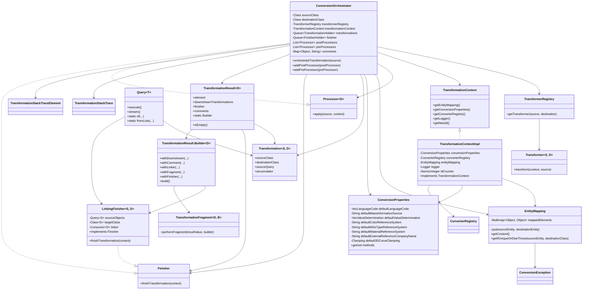

## KBL to VEC Converter

A detailed description can be found in the Implementation Guidelines of the ECAD-WIKI.

Currently unsupported features (future work):

- Copyright Information for PartVersions
- Changes for Parts & Documents
- Standalone `Module_configuration`s that are not part of a `Module`.
- `PlaceableElementSpecification` and `PlaceableElementRole` are created for all Elements that are potentially
  placable (from the Model in the KBL). However, this might not be true for everthing. E.g. the KBL says that an
  `AssemblyPartOccurrence` is a `LocatedComponent` and thus potentially placeable. However, a USB Cable will not be
  placed at all. May a post processing should be introduced to remove Role & Specs from elements that are not acutally
  used.
- `TerminalRole` without Specification; can't be derived from KBL data
- Placement of `ComponentBoxConnector`
- Harness Configuration
- Module Family
- Fuse
- Component
- Coupling

### Configuration

The conversion is configured with `ConversionProperties`, passed to the converter:

```java
final ConversionProperties properties = new ConversionProperties();
properties.setDefaultLanguageCode(VecLanguageCode.EN);
final KblToVecConverter converter = new KblToVecConverter(properties);
```

Besides the default language of plain KBL strings, it holds the reference systems of colours, wire types and
materials, the company names of generated documents and the clamping of 3D curves. KBL has no source and no
determination type for masses; `defaultMassInformationSource` and `defaultValueDetermination` are written into every
`MassInformation` if set, they are unset by default.

#### Date formats

KBL does not define a format for its date strings (`Change_date`, `Creation.Date`, `Approval.Date`), VEC uses
`xs:dateTime`. The formats are set as [`DateTimeFormatter`](https://docs.oracle.com/en/java/javase/21/docs/api/java.base/java/time/format/DateTimeFormatter.html)
patterns, they are tried in the given order. A pattern without a time results in the start of the day. Dates that match
none of the patterns are omitted with a warning (a `Creation` without a date is omitted entirely, its date is mandatory
in VEC).

The default is `dd.MM.yyyy` (e.g. `27.01.2015`) and `ddMMyy` (e.g. `270115`), the formats found in VOBES files.
Other formats:

```java
final ConversionProperties properties = new ConversionProperties();
// ISO 8601, e.g. 2015-01-27 or 2015-01-27T10:15:00
properties.setDateFormats(List.of("yyyy-MM-dd", "yyyy-MM-dd'T'HH:mm:ss"));
// German, e.g. 27.01.2015
properties.setDateFormats(List.of("dd.MM.yyyy"));
```

### Architecture


